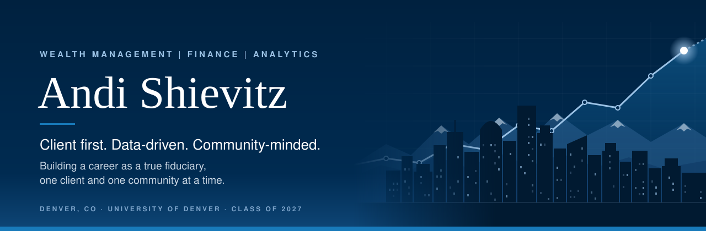
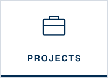
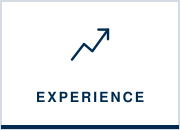
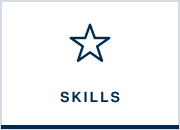
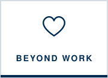
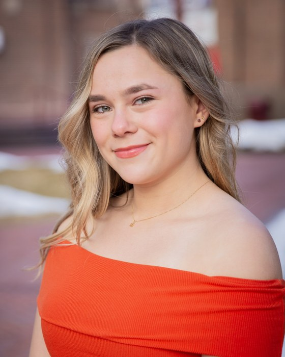

  

<h2 align="center">Welcome! I'm Andi, and this is a little about me.</h2>

  
  
  
  
  
  

---

<table>
<tr>
<td width="32%" align="center" valign="top">
  
    
  <b>Andi R. Shievitz</b> 
  Denver, CO  
  <a href="mailto:andi.shievitz@gmail.com">andi.shievitz@gmail.com</a> 
  <a href="https://www.linkedin.com/in/Andi-Shievitz">LinkedIn</a> &nbsp;|&nbsp; <a href="Andi-Shievitz-Resume.pdf">Resume (PDF)</a>
</td>
<td width="68%" valign="top">

### My brand

> **I want to be a true fiduciary: honest with every client, focused on giving people a hand up, and the teammate who takes friction out of the work so the whole team can grow.**

### Hi, I'm Andi

I'm a senior at the **University of Denver's Daniels College of Business**, majoring in **Business Information & Analytics** with minors in **Finance** and **Marketing**. I graduate in **June 2027**.

I grew up in Hinsdale, Illinois, outside Chicago, graduated high school early *summa cum laude*, and headed west to Denver, which has become home. I've spent college working inside wealth management teams at **Morgan Stanley** and **Merrill Lynch**, and the more I see, the surer I am: I want to be the advisor who tells clients the truth and helps them stand on their own.

</td>
</tr>
</table>

---

## How I work

I think of myself as an enzyme on a team: I don't replace processes that already work, I make them run faster. I find the friction, take it out, and give the team its time back for what matters most: clients.

| Where the friction was | What I did | What it freed up |
|:--|:--|:--|
| **Morgan Stanley:** onboarding a new client meant hours with the ACATS team combing through long statements from their old firm to confirm we could hold every position | Built an **AI agent** that extracts every position and flags only the few that need verification | The ACATS team reviews a short exception list instead of the whole statement. [Try the demo](experience.md#try-my-work-interactive-demo) |
| **Morgan Stanley:** before fund-raising conversations, CSAs had to piece together spending across ~25 accounts per client, full of transfers and card payments | Built an **AI agent** that consolidates every account, strips out transfers, card payments, and investments, and writes a one-page brief | CSAs see a client's *true* spending and liquidity before the conversation. [Try the demo](experience.md#try-my-work-interactive-demo) |
| **Morgan Stanley:** private-fund capital call information was scattered across update calls and documents | Built **one monthly tracker** for capital calls and distributions across **&#36;50M+** in client raises | Advisors could plan client liquidity ahead of time instead of reacting. [See the project](projects.md#capital-call--distribution-tracker) |
| **Merrill Lynch:** annual reviews required pulling account data together for a **500+ client** practice | Kept Salesforce records current and **compiled account data** ahead of each review | Advisors walked into client meetings prepared. [See my experience](experience.md) |
| **DU Business Communications:** instructors couldn't give detailed feedback on every student rehearsal | **Led the TA team that rolled out VirtualSpeech VR**, giving students AI feedback on practice runs | More practice reps for every student, without more instructor hours. [See the project](projects.md#virtualspeech-vr-integration--email-audits) |

**My goal on any team:** take out enough friction that the team could **double its business without doubling its workload**.

---

## Client first: honesty and a hand up

Being a fiduciary is a legal standard. For me, it's personal, and it comes down to two things.

**Honesty, even when it isn't the easy answer.** Presenting account performance to clients next to Financial Advisors at Merrill Lynch showed me that trust comes from straight answers in good years and bad ones. I hold my own work to the same standard. When the data in my statistics project proved some of my guesses wrong, I reported it instead of burying it. A client deserves at least that much.

**A hand up, not a handout.** The best help leaves someone more capable than before. As a TA, I didn't fix students' presentations for them. I built a model presentation and showed them *how* to research, cite their evidence, and pitch with confidence, so they could do it on their own. With clients, that means explaining the *why* behind every recommendation until they truly understand their own money. And it doesn't stop at the office door: as Treasurer of Chabad at DU, I stand up on the Student Government Finance Board for the resources my community needs, and as a Spanish speaker, I can meet more families in their own language.

<!-- Make this even more personal: add 1–2 sentences about a specific moment, client, or person who showed you why honesty or a hand up matters. -->

---

## What I'm looking for

A full-time role starting in 2027 in **wealth management or financial advising**, on a team where I can take on the processes that slow advisors down so they can serve more clients, while I learn what it takes to become a trusted advisor myself.

---

## What I value

| | |
|:--|:--|
| **Honesty** | Straight answers, good news or bad. Trust is built on the hard conversations. |
| **A hand up** | Help that leaves people more confident and capable, not more dependent. |
| **Efficiency** | Every hour lost to friction is an hour taken from a client. I find it and fix it. |
| **Accuracy** | When the money belongs to someone's family or future, "close enough" isn't good enough. |
| **Community** | My work should make a difference people can see, from Chabad at DU to the classroom. |

---

## A few things about me

| Academics | Community | Background |
|:--|:--|:--|
| **Dean's List every quarter**, **3.87 GPA**, and a **4.00** in each of my last three quarters | **Treasurer of Chabad at DU** and a member of the **Student Government Finance Board** | Graduated high school **early**, *summa cum laude* |
| Fluent in **Spanish**, with the **Seal of Biliteracy** | Former **Teaching Assistant** for Business Communications | A **Chicago-area native** who now calls **Denver** home |

---

  <b>Let's connect.</b> I'd love to hear about wealth management and financial advisory roles. 
  <a href="mailto:andi.shievitz@gmail.com">andi.shievitz@gmail.com</a> · <a href="https://www.linkedin.com/in/Andi-Shievitz">LinkedIn</a>

