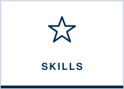
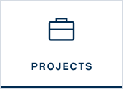
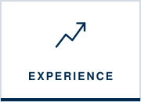

  
  
  
  
  
  

My resume shows what I've done. This page shows who I am when nobody's grading me. Being a true fiduciary doesn't stop at the office: it means showing up for my community, leading with integrity, and caring about the people around me.

---

## Chabad of South Denver | DU · Treasurer
**January 2024 – Present**

As Treasurer, I'm essentially the CFO of a student organization. I **manage the balance sheet**, keep the financial records, and make sure budgeting and expense tracking are accurate. I also **handle purchasing and vendor relations** for events, so every event is stocked on time and on budget.

I also **represent Chabad on the United Student Government Finance Board**, where I take part in funding decisions for student organizations across campus and advocate for my organization's needs.

> **What an employer gets:** someone who already acts as a steward of other people's money, managing it carefully and transparently for the community it serves, and who can make a clear case for resources in front of a board.

---

## Delta Sigma Pi — Alpha Nu Chapter · Senior Vice President
**September 2024 – September 2025**

Delta Sigma Pi is a co-ed professional business fraternity. As **Senior Vice President and Head of Recruitment**, I **led strategic recruitment initiatives** to grow membership while building chapter engagement and community involvement.

> **What an employer gets:** someone who can pitch, build a pipeline, and turn interest into commitment. That's the same skill set as growing a client base.

---

## Bilingual: English & Spanish

I'm fluent in Spanish and earned the **Seal of Biliteracy**. Speaking a second language makes me a better listener and lets me connect with clients and colleagues in their own language.

---

## Outside the office

| Knitting & crochet | Kayaking | Lagree | And more |
|:--|:--|:--|:--|
| Long projects that reward patience and attention to every stitch | Getting out on Colorado's lakes and rivers | High-intensity, low-impact workouts that build consistency | I'm always up for trying something new |

My favorite crossover: I once turned a crocheted blanket into a statistics project. [See the analysis →](projects.md#granny-square-analytics-how-fast-can-i-crochet)

---

## Life in Colorado

I'm a Chicago-area native (Hinsdale, IL) who moved west for DU, and Denver has become home. It's the community I want to serve.

---

---

    
  <b>Thanks for visiting!</b> Let's connect: <a href="mailto:andi.shievitz@gmail.com">andi.shievitz@gmail.com</a> · <a href="https://www.linkedin.com/in/Andi-Shievitz">LinkedIn</a>

