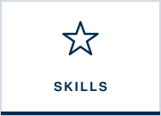
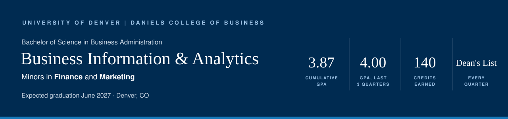

  
  
  
  
  
  

My degree combines three things I use every day in wealth management: **analytics** to get the numbers right, **finance** to understand what they mean for a client, and **marketing and communication** to explain them clearly. This page focuses on what I can *carry forward*: the tools I learned and where I've already put them to work.

**Jump to:** [Skills I carry forward](#skills-i-carry-forward) · [Analytics major](#business-information--analytics-major) · [Finance minor](#finance-minor-and-accounting) · [Marketing minor](#marketing-minor) · [Business core](#business-core-and-leadership) · [Certifications & honors](#certifications-and-honors)

---

## Skills I carry forward

| Skill | Where I learned it | Where it already shows up |
|:--|:--|:--|
| **Automating repetitive work** | INFO 3100 Automating Business Processes (Excel VBA, Python) · BUS 1440 Fourth Industrial Revolution (AI and automation) | Built AI agents on Morgan Stanley's internal platform for new-client onboarding and CSA spending summaries. [Try the demo](https://andishievitz.github.io/andishievitz/) |
| **Organizing data so it can be trusted** | INFO 1010 Analytics I · INFO 3140 Foundations of Information Management · INFO 3240 Enterprise Information Management (database design, SQL) | Kept allocations current for 95 households (&#36;3.7B) at Morgan Stanley and maintained client records in Salesforce at Merrill Lynch. |
| **Drawing honest conclusions from data** | INFO 1020 Analytics II · INFO 2020 Analytics III · INFO 3110 Applied Nonparametric Statistics | Designed my own 80-observation study and ran 13 statistical analyses on it. [See the project](projects.md#granny-square-analytics-how-fast-can-i-crochet) |
| **Reading a client's financial picture** | ACTG 2200 Financial Reporting · ACTG 2300 Accounting for Decision Making · FIN 2800 Financial Decision Making · FIN 3300 Investments | Tracked capital calls and distributions for &#36;50M+ in private-market raises and reviewed statements during new-client onboarding. |
| **Reaching the right audience** | MKTG 3485 Search Engine Marketing (Google Ads, Google Analytics) · MKTG 2930 Marketing Research | Restructured my team's bios for search and ran a Google Ads campaign at Morgan Stanley. [See the project](projects.md#search-visibility--client-acquisition) |
| **Explaining it clearly** | BUS 3000 Strategic Business Communications · WRIT 1122 & 1133 · MKTG 2800 & 3460 (team pitches) | Took Business Communications in Autumn 2024, then became a **TA for the same course** the next quarter. Presented account performance to clients at Merrill Lynch. |
| **Leading and motivating people** | MGMT 2100 Leading High Performance Organizations · Daniels Professional Development Program I–III | Led the TA team's VirtualSpeech rollout and ran recruitment for Delta Sigma Pi. [See my experience](experience.md) |

---

## Business Information & Analytics major

The analytics major moves from statistics to databases to predictive modeling, always applied to business decisions.

| Course | When | What I learned | Tools & skills I carry forward |
|:--|:--|:--|:--|
| **INFO 1010** · Analytics I: Data & Analysis | Autumn 2023 | Collecting, cleaning, and organizing messy data before analyzing it | Excel, data cleansing, descriptive statistics, charts |
| **INFO 1020** · Analytics II: Statistics & Analysis | Spring 2024 | Probability and inference for business decisions: telling a real effect from noise | Hypothesis testing, confidence intervals, decision analysis, MiniTab |
| **INFO 2020** · Analytics III: Business Modeling | Autumn 2024 | Building models that explain and forecast outcomes | Multiple regression, time series forecasting, spreadsheet modeling, simulation |
| **INFO 3100** · Automating Business Processes | Winter 2026 | Turning repetitive manual work into automated workflows | Advanced Excel, VBA, Python, pivot tables |
| **INFO 3140** · Foundations of Information Management | Winter 2026 | Designing a relational database from scratch | ER modeling, normalization, SQL |
| **INFO 3110** · Applied Nonparametric Statistics | Spring 2026 | Drawing honest conclusions when data isn't "normal" or samples are small. [See my final project](projects.md#granny-square-analytics-how-fast-can-i-crochet) | Sign & rank tests, Kruskal-Wallis, Spearman correlation, MiniTab |
| **INFO 3200** · Data Mining & Visualization | Spring 2026 | The full predictive modeling process, from exploring data to sharing results in dashboards | Decision trees, logistic regression, k-NN, clustering, PCA, Tableau |
| **INFO 3240** · Enterprise Information Management | Spring 2026 | Writing production-style SQL for enterprise databases | T-SQL, Microsoft SQL Server, Visual Studio |
| **INFO 3300** · Data Warehousing & Business Intelligence | Autumn 2026 · *in progress* | Combining data from many systems into one source for reporting | Data warehouse design, dimensional modeling, BI reporting |
| **INFO 3340** · Project Management & Simulation | Autumn 2026 · *in progress* | Managing analytics projects and planning for uncertainty | Project management, Monte Carlo simulation |
| **INFO 3700** · Analytics Careers | Autumn 2026 · *in progress* | Presenting my work to employers, including building this portfolio | Git, GitHub, Markdown, personal branding |

**Still ahead in 2027:** Complex Data Analytics (INFO 3400), Optimization Modeling (INFO 3440), and the Capstone (INFO 3500), where I'll solve a real business problem for a partner company.

---

## Finance minor and accounting

The finance side of my degree is what lets me understand a client's whole financial picture, from the statements to the markets.

| Course | When | What I learned | Tools & skills I carry forward |
|:--|:--|:--|:--|
| **ECON 1020** · Economics: A Critical Introduction | Winter 2024 | How markets, incentives, and policy shape economic outcomes | Economic reasoning |
| **ACTG 2200** · Introduction to Financial Reporting | Winter 2025 | Analyzing transactions, preparing financial statements, and reading annual reports and 10-Ks | Balance sheets, income statements, cash flows, 10-K analysis |
| **ACTG 2300** · Accounting for Decision Making | Spring 2025 | Using accounting information to make decisions, not just record them | Cost behavior, cost-volume-profit analysis, budgeting |
| **FIN 2800** · Financial Decision Making | Autumn 2025 | Core financial analysis and valuation | Ratio analysis, leverage, NPV, IRR, forecasting |
| **FIN 3110** · Financial Institutions | Winter 2026 | How banks and other institutions are managed and connect to money and capital markets | Bank management, interest rates, capital markets |
| **FIN 3300** · Investments | Autumn 2026 · *in progress* | Securities, markets, regulation, and how to measure risk and return | Risk and return, fundamental and technical analysis |

---

## Marketing minor

I earned an **A in all six marketing courses**. Marketing taught me how to understand an audience and reach it, which is exactly what client acquisition requires.

| Course | When | What I learned | Tools & skills I carry forward |
|:--|:--|:--|:--|
| **MKTG 2800** · Introduction to Marketing | Autumn 2024 | Judging a product's feasibility with real market data, then building and presenting a marketing plan as a team | Market analysis, marketing plans, team presentations |
| **MKTG 3630** · International Marketing | Spring 2025 | Adapting strategy for global markets and cultures | Global market strategy |
| **MKTG 2930** · Methods of Marketing Research | Autumn 2025 | Discovering customer needs with qualitative and quantitative research | Survey design, customer interviews, data analysis |
| **MKTG 3475** · Mobile Marketing | Autumn 2025 | Mobile search, apps, ads, and tracking return on investment | ROI tracking, design thinking, app prototyping |
| **MKTG 3485** · Search Engine Marketing | Autumn 2025 | How people search and how to make a business easy to find | Google Ads, Google Analytics, SEO |
| **MKTG 3460** · Advertising Creative Strategy | Spring 2026 | Taking a real brand campaign from strategy brief to finished ads | Campaign strategy, ad design, media selection, pitching |

---

## Business core and leadership

| Course | When | What I learned | Tools & skills I carry forward |
|:--|:--|:--|:--|
| **BUS 1440** · The Fourth Industrial Revolution | Autumn 2023 | Business's role in society and how AI, automation, and other emerging technology change it | Technology strategy, AI awareness |
| **MGMT 2100** · Leading High Performance Organizations | Spring 2024 | Why some organizations outperform others: the people side of performance | Motivation, teamwork, organizational behavior |
| **BUS 3000** · Strategic Business Communications | Autumn 2024 | Professional writing and presenting, ending in a real client project. *I became a TA for this course the next quarter.* | Business writing, presenting, client projects |
| **LGST 2000** · Foundations of Business Law | Winter 2025 | Contracts, corporate responsibility, and regulation, including securities law | Legal and regulatory awareness |
| **MGMT 3000** · Business Policy & Strategy | Winter 2026 | The big strategic decisions executives make and how to measure their effect on performance | Strategic analysis |
| **BUS 1099 / 2099 / 3099** · Daniels Professional Development Program I–III | 2024–2026 | Resumes, interviewing, LinkedIn, professional etiquette, and career-ready tool training | Professional presence, networking |

**A broad foundation, too:** Calculus I, Intermediate Spanish, two writing and research courses, Philosophy of Mind, Introduction to Political Thought, Page to Stage (theatre), and a three-course science sequence on contemporary issues.

---

## Certifications and honors

| | |
|:--|:--|
| **Microsoft Office certifications** | Word, PowerPoint, and Excel |
| **Google Analytics certification** | Web analytics and campaign measurement |
| **Dean's List** | Every quarter, Autumn 2023 – Spring 2026 |
| **4.00 term GPA** | Autumn 2025, Winter 2026, and Spring 2026 |
| **Seal of Biliteracy** | Spanish |
| **Hinsdale Central High School** | Early graduate, *summa cum laude*, June 2023 |

<!-- If you have Credly (or other) badge links for your certifications, add them like this:
| **Microsoft Office certifications** | [Excel](https://www.credly.com/badges/...) · [Word](...) · [PowerPoint](...) | -->

---

  
  

