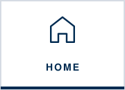
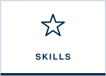
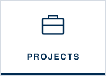
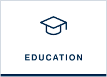
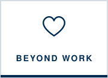
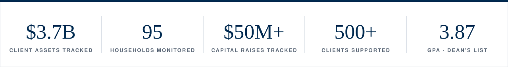
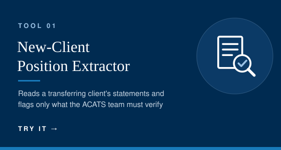
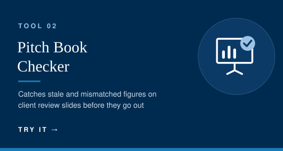
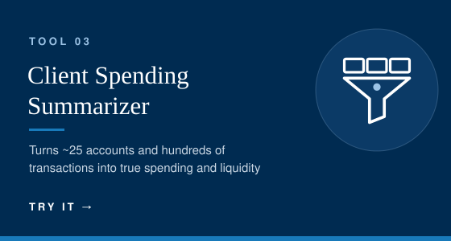
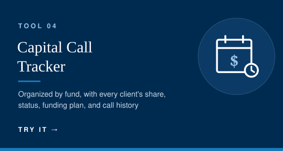

  
  
  
  
  
  

Three roles, one theme: **putting the people I serve first** by making complex information accurate, organized, and easy to act on, whether that's for a wealth management team, a client, or a classroom of students.

## Try my work: interactive demo

At Morgan Stanley, I built AI agents and trackers that took manual work off my team's plate. Client data is confidential, so I **rebuilt the work with mock data** so you can try it yourself: run the agents, edit the inputs, and see what they catch.

> **Note: recreated with mock data.** Every client, account, fund, and figure in the demo is fictional, and security prices are illustrative. The original agents ran on Morgan Stanley's internal AI platform; the demo recreates their logic in JavaScript. It is my own work and is not affiliated with or endorsed by Morgan Stanley. You can also [view the mock data](mock-data.json).

  
  
  
  

---

## Roles at a glance

| When | Role | Organization |
|:--|:--|:--|
| Jan 2026 – Jul 2026 | [PWM Intern](#morgan-stanley--pwm-intern) | Morgan Stanley, Private Wealth Management, 1550 Group · Denver, CO |
| Jul 2025 – Sep 2025 | [Seasonal Client Associate](#bank-of-america--merrill-lynch--seasonal-client-associate) | Bank of America – Merrill Lynch · Oak Brook, IL |
| Jan 2025 – Jan 2026 | [Teaching Assistant](#university-of-denver--teaching-assistant) | Business Communications, Daniels College of Business · Denver, CO |

---

## Morgan Stanley · PWM Intern
**Private Wealth Management, 1550 Group · Denver, CO · January 2026 – July 2026**

The 1550 Group is a private wealth team serving high-net-worth households. As an intern, I worked across portfolio operations, private markets, marketing, and AI-driven process improvement.

**Projects & accomplishments**
- Tracked portfolio allocations across **95 client households totaling &#36;3.7 billion** in a comprehensive Excel spreadsheet, keeping the team's positioning accurate and current.
- Monitored **private equity and private credit** fund update calls and did independent research to build a **monthly capital call & distribution tracker** used to manage **&#36;50M+ in client capital raises**. → [See the project](projects.md#capital-call--distribution-tracker) · [Try the demo](https://andishievitz.github.io/andishievitz/#t4)
- Designed and implemented **AI agents** on Morgan Stanley's internal AI platform to flag the few positions in a new client's transfer that need ACATS review, check pitch book accuracy, and consolidate client spending across ~25 accounts for CSAs. → [See the project](projects.md#ai-agents-for-private-wealth-management) · [Try the demo](https://andishievitz.github.io/andishievitz/#t1)
- Reformatted team bios for website-crawler readability and ran a **Google Ads campaign** to boost SEO and client acquisition. → [See the project](projects.md#search-visibility--client-acquisition)

|  Technologies |  Soft skills |  What I took away |
|:--|:--|:--|
| Excel, Morgan Stanley internal AI platform, Google Ads, Google Analytics, Microsoft Office | Attention to detail, independent research, initiative, discretion with confidential data | Small process improvements add up when you're working at a &#36;3.7B scale, and AI is most useful when it's built around how a team actually works. |

---

## Bank of America – Merrill Lynch · Seasonal Client Associate
**Oak Brook, IL · July 2025 – September 2025**

I supported a **Forbes Best-in-State Wealth Management Team**, handling the client records, data preparation, and day-to-day communication that keep a large practice running smoothly.

**Projects & accomplishments**
- Maintained detailed client records in **Salesforce**, keeping documentation complete and current to support client relationship management.
- Compiled and organized client account data for **annual reviews**, and **presented account performance to clients** in person and virtually alongside Financial Advisors.
- Served as a primary point of contact for a **500+ client base** by phone, email, and in person.

|  Technologies |  Soft skills |  What I took away |
|:--|:--|:--|
| Salesforce, Excel, Microsoft Office | Client communication, professionalism, presenting, organization | Behind every account number is a person. Presenting performance to clients taught me to lead with clarity and empathy, not jargon. |

---

## University of Denver · Teaching Assistant
**Business Communications, Daniels College of Business · Denver, CO · January 2025 – January 2026**

Business Communications teaches Daniels students to write and present professionally. As a TA, I worked with faculty on both teaching and improving the curriculum.

**Projects & accomplishments**
- Built an **example persuasive presentation**, *Puppy Hugs for Productivity*, to show students how to research credible sources, cite every statistic, and structure a confident business pitch. → [See the project](projects.md#research--presentation-coaching-puppy-hugs-for-productivity)
- Developed **curriculum enhancements** by adding **Outlook email audits** to strengthen students' professional communication skills.
- Worked with faculty to give feedback, grade coursework, and support a high-quality learning environment.
- **Led a team of TAs** in integrating **VirtualSpeech** VR software into the curriculum so students get AI feedback on their presentation skills, which increased engagement and improved learning outcomes. → [See the project](projects.md#virtualspeech-vr-integration--email-audits)

|  Technologies |  Soft skills |  What I took away |
|:--|:--|:--|
| VirtualSpeech (VR + AI feedback), Canva, Outlook, Microsoft Office | Research coaching, leadership, constructive feedback, collaboration with faculty | Leading peers means getting buy-in, not giving orders, and new technology only works if people feel supported using it. |

---

  
  

