

  
  <a href="skills.md">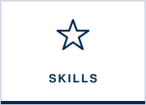</a>
  
  
  
  

My projects come from three parts of my college career: **teaching**, **analytics coursework**, and **internships in wealth management**. Each section starts with a short overview. **Click any project to expand it.** Every project follows the same format: **the problem → what I did → the challenges → what I made → the impact.**

| Section | Projects |
|:--|:--|
| [**01 · Teaching Assistant**](#teaching-assistant) | [Research & Presentation Coaching](#research--presentation-coaching-puppy-hugs-for-productivity) · [VirtualSpeech VR Integration & Email Audits](#virtualspeech-vr-integration--email-audits) |
| [**02 · DU Analytics**](#du-analytics) | [Granny Square Analytics: How Fast Can I Crochet?](#granny-square-analytics-how-fast-can-i-crochet) |
| [**03 · Internship Experience**](#internship-experience) | [AI Agents for Private Wealth Management](#ai-agents-for-private-wealth-management) · [Capital Call & Distribution Tracker](#capital-call--distribution-tracker) · [Search Visibility & Client Acquisition](#search-visibility--client-acquisition) |

---

**About this section:** From January 2025 to January 2026, I was a Teaching Assistant for **Business Communications** at the Daniels College of Business, a course every Daniels student takes to learn professional writing and presenting. I worked with faculty to grade, give feedback, and improve the curriculum. My focus was helping students **research credible evidence** and **present with confidence**. These projects show how I teach, coach, and lead a team, the same skills I use to explain financial decisions to clients.

<b>Research & Presentation Coaching: Puppy Hugs for Productivity</b> &nbsp;·&nbsp; <i>Business Communications · Teaching Assistant · 2025</i> 
A model persuasive presentation I built to teach students how to research credible evidence and present with confidence.

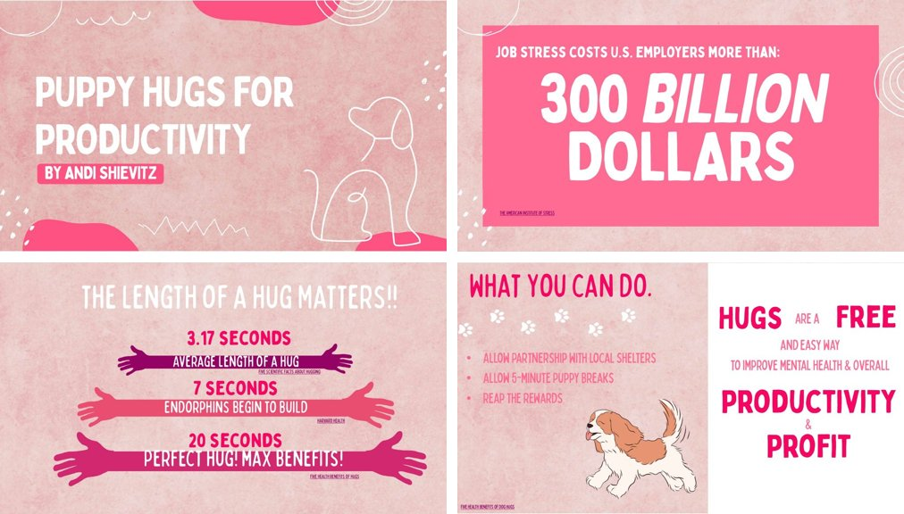

| | |
|:--|:--|
| **Business problem** | Business Communications asks students to make persuasive business proposals, and many struggle in two places: **finding credible research** to back up their ideas, and **feeling confident** in front of an audience. A great idea falls flat without evidence, and great evidence falls flat if the speaker is nervous. |
| **What I did** | **Built a model presentation.** I created *Puppy Hugs for Productivity*, an example persuasive proposal that shows students what a strong, research-backed pitch looks like. It's a lighthearted topic, but it's built on a serious structure: it opens with the cost of the problem (**job stress costs U.S. employers more than &#36;300 billion**, per the American Institute of Stress), backs every claim with a **cited source** (Statista, the National Center for Biotechnology Information, Harvard Health), answers the objection up front ("Waste of time?"), and ends with a **clear, specific ask** tied to productivity and profit.  **Coached students on research.** I used the example to show students how to find credible sources, put a citation on every statistic, and turn their research into a recommendation.  **Built confidence.** I gave students honest, encouraging feedback on their work, so they walked into their presentations knowing their argument held up. |
| **Challenges** | Every student starts from a different place. Some need help finding sources, others need help with nerves. I had to make the example simple enough to follow but strong enough to set a high bar, and give feedback that was honest without discouraging anyone. |
| **Artifacts** | [Example presentation: *Puppy Hugs for Productivity* (PDF)](Puppy-Hugs-for-Productivity-Example.pdf) |
| **Value & impact** | Students had a concrete model of "what good looks like" before building their own pitches. The same skills drive my finance work: **do the research, cite the facts, and explain them so the client feels confident in the decision.** |

<b>VirtualSpeech VR Integration & Email Audits</b> &nbsp;·&nbsp; <i>Business Communications · Teaching Assistant · 2025</i> 
Led the TA team that brought VR presentation practice with AI feedback into a course every Daniels student takes.

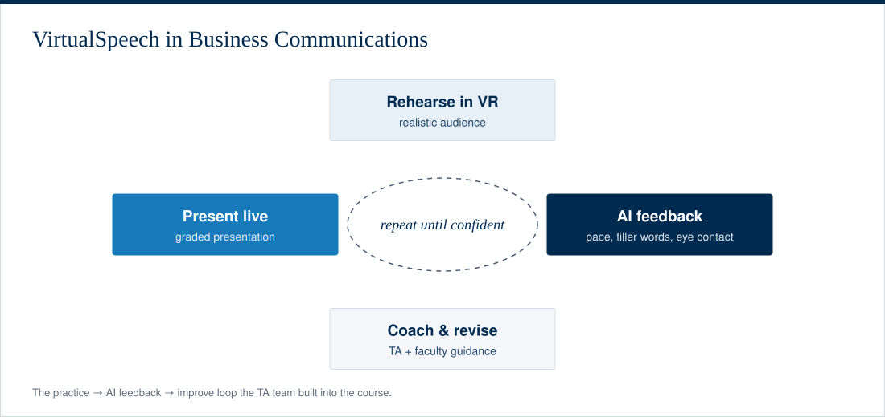

| | |
|:--|:--|
| **Business problem** | Students get only a few chances to present in front of a real audience each quarter, and it's hard for instructors to give detailed feedback on every rehearsal. Many students also arrive without strong professional email habits, a skill they'll use every day at work. |
| **What I did** | I **led a team of TAs in integrating VirtualSpeech**, a virtual reality platform, into the curriculum. Students rehearse in front of a virtual audience and get **AI feedback** on their delivery before presenting live. I also **added Outlook email audits** to the course, working with faculty to review students' professional emails and give feedback. |
| **Challenges** | Bringing new technology into a live course meant coordinating a team of TAs, working with faculty on how it fit the curriculum, and helping students who had never used a VR headset feel comfortable with it. |
| **Artifacts** | The practice loop diagram above. <!-- Add: a photo of students using the headsets, or the email audit rubric you created --> |
| **Value & impact** | More practice reps and faster, more specific feedback for every student. This **increased engagement and improved learning outcomes** in a course every Daniels student takes. |

---

**About this section:** As a **Business Information & Analytics** major at the Daniels College of Business, I've taken coursework in statistics, databases, automation, and data mining (see my [Education page](education.md) for the full list). These are projects where I designed the analysis myself: collecting data, choosing the right methods, and turning results into a clear story. Statistics is how I make sure a recommendation is backed by evidence, not just a hunch.

<!-- To add another class project: copy the project block below, upload your files, and add it to the table at the top of this page.
     YouTube thumbnail link:  -->

<b>Granny Square Analytics: How Fast Can I Crochet?</b> &nbsp;·&nbsp; <i>Applied Nonparametric Statistics (INFO 3110) · Final Project · Spring 2026</i> 
Designed my own 80-observation study and ran 13 statistical analyses, choosing parametric or nonparametric tests to fit the data.

  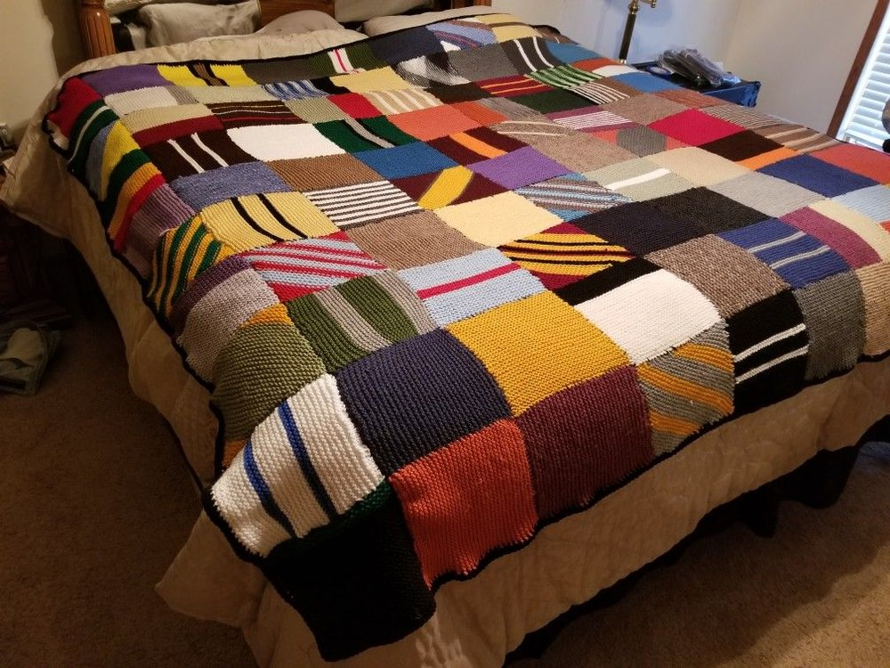
  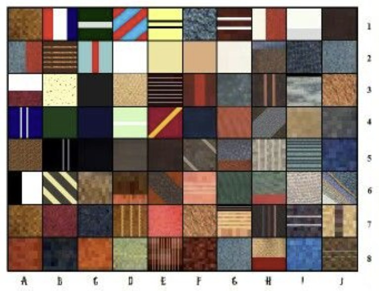

| | |
|:--|:--|
| **Business problem** | I was making a Harry Potter–themed Tunisian crochet blanket as a gift, with a firm finish date of August 9. With **80 squares** to make, I wanted real answers: *How long does a square actually take? What slows me down? Does yarn brand change the size of a square? And what is all that handmade work really worth?* These are the same questions a business asks about any production process: cycle time, drivers of cost, quality consistency, and the true value of labor. |
| **What I did** | I designed the full study myself. I coded every square on a grid (**A1–J8**) as an experimental unit, and for each one I recorded **time** (stopwatch), **yarn length** (line counter), **pre-blocked size** (digital caliper), weight, stitch count, direction, pattern, number of colors, yarn brand for each color, and whether I thought the square came out "pretty" or "ugly." That gave me a **21-variable dataset**. I then ran **13 analyses in MiniTab**, choosing parametric or nonparametric tests based on what the data could support: one-sample t-test and **sign test**, **Wilcoxon signed-rank**, one-way and two-way **chi-square**, simple linear regression, **Pearson vs. Spearman** correlation, two-sample t-test, **Mann-Whitney rank-sum**, two **ANOVAs**, **Kruskal-Wallis**, and **multiple linear regression**. |
| **Challenges** | **Consistency:** measuring 80 squares the same way over weeks takes discipline, because one sloppy measurement weakens every test. **Picking the right test:** some groups were tiny (only 7 diagonal squares, and 4 squares of one yarn brand), so I used nonparametric tests that don't assume normal data, and I flagged where MiniTab warned that small samples limit accuracy. **Reading results honestly:** some of my guesses were wrong. For example, slower squares weren't bigger (R² = 0.66%), and I reported that instead of hiding it. |
| **Artifacts** | [Full presentation slides (PDF)](Shievitz-Crochet-Analysis-Slides.pdf) · the findings summary and charts below |
| **Value & impact** | The project turned a hobby into a full analytics workflow: study design, data collection, cleaning, testing, and storytelling. It also connects to finance: **real-world data is rarely "normal,"** and investment returns are no exception, so knowing when to use nonparametric methods leads to more honest conclusions. And the final number hits home: **157 hours, 40 minutes** of work and **132,822 stitches** that would cost **&#36;3,037** at minimum wage, on top of **&#36;643 in yarn**. That's a reminder to always count the true cost, not just the visible one. |

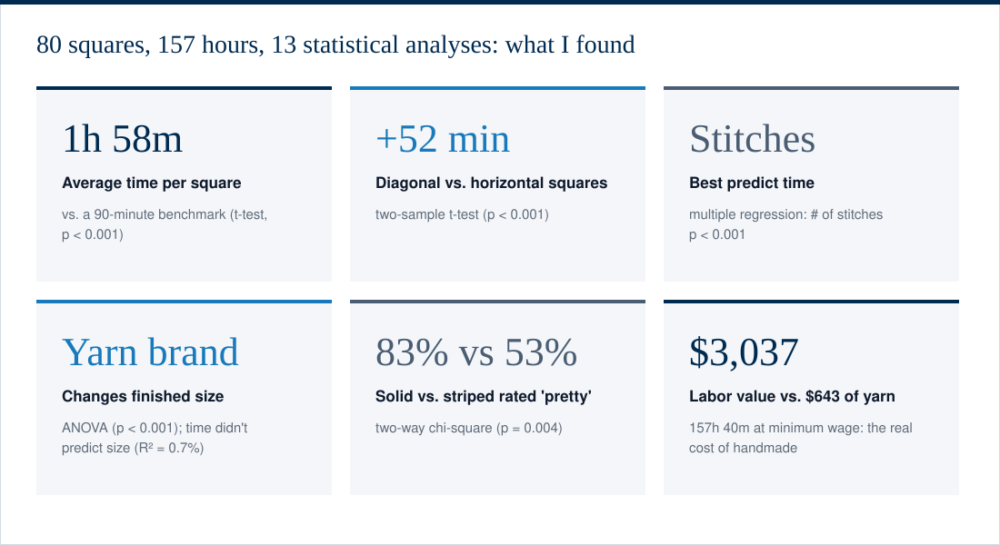

<b> Click to see the charts and test results</b>

 

| Question | Test | Result |
|:--|:--|:--|
| Do squares take longer than 90 minutes (5,400 s)? | One-sample t-test | Yes. Mean **1h 58m**, 95% CI 6,777–7,413 s (t = 10.61, p < 0.001) |
| Is the *median* time different from 90 minutes? | Sign test | Yes. Median **1h 55m**; 74 of 80 squares took longer than 90 min (p < 0.001) |
| Is the median size different from the 49 in² target? | Wilcoxon signed-rank | Yes. Median **43.8 in²**, smaller than planned (p < 0.001) |
| Are "pretty" and "ugly" squares equally common? | One-way chi-square | No. 54 pretty vs. 26 ugly (χ² = 9.8, p = 0.002) |
| Does time spent predict a square's size? | Simple regression, Pearson & Spearman | No. R² = 0.66%, r = 0.08, ρ = 0.04 |
| Is pattern related to "pretty" vs. "ugly"? | Two-way chi-square | Yes. 33 of 40 solids were pretty vs. 21 of 40 stripes (p = 0.004) |
| Do diagonal squares take longer than horizontal ones? | Two-sample t-test | Yes, by about **52 minutes** (95% CI 39–65 min, p < 0.001) |
| Do pretty squares take longer than ugly ones? | Mann-Whitney rank-sum | No significant difference (p = 0.12) |
| Does the number of colors affect time? | ANOVA | Yes (F = 3.43, p = 0.012) |
| Does yarn brand affect size? | ANOVA | Yes, strongly (F = 38.79, p < 0.001) |
| Does yarn brand affect time? | Kruskal-Wallis | Yes (H = 11.17, p = 0.025), with a small-sample caution |
| What best predicts time? | Multiple regression | **Stitch count** (p < 0.001). Colors, weight, and size were not significant once stitches were included |

  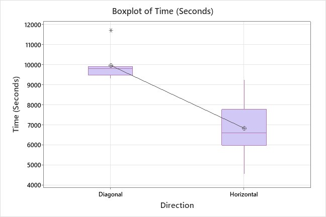
  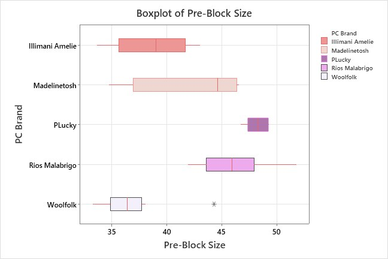
  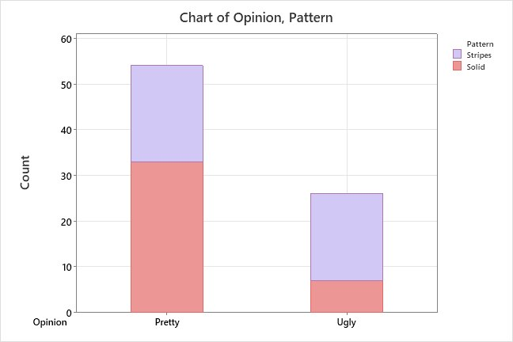
  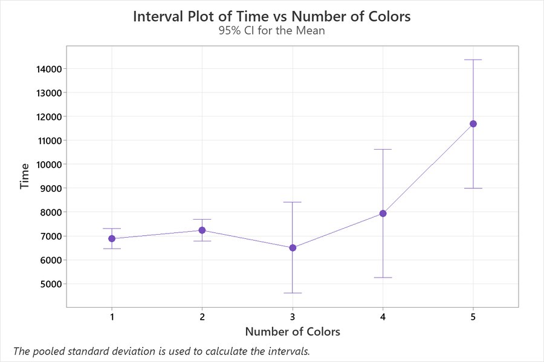

---

**About this section:** From January to July 2026, I interned with the **1550 Group at Morgan Stanley Private Wealth Management** in Denver, a team serving **95 client households with &#36;3.7 billion in assets**. I worked across portfolio operations, private markets, marketing, and AI-driven process improvement. Client information at Morgan Stanley is confidential, so the visuals here are **illustrative diagrams and mock-ups I recreated with no real client data**. For more on the role itself, and on my time at Merrill Lynch, see my [Work Experience page](experience.md).

<b>AI Agents for Private Wealth Management</b> &nbsp;·&nbsp; <i>Morgan Stanley PWM, 1550 Group · 2026</i> 
Three AI agents that cut new-client onboarding review, pitch book checks, and spending prep down to the few items that need a person.

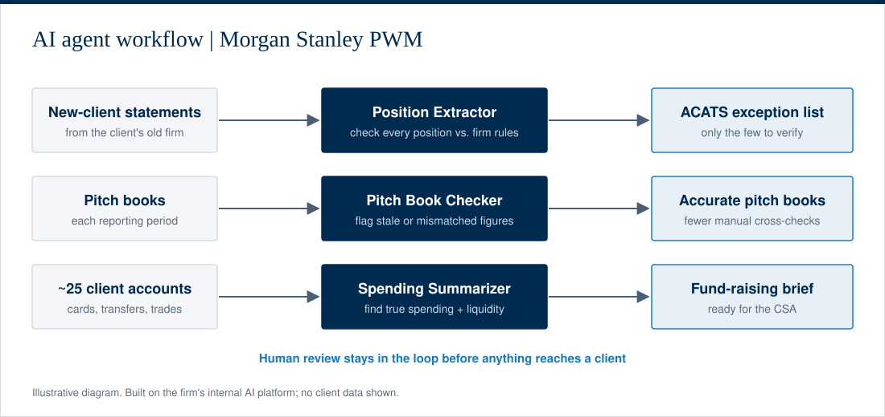

| | |
|:--|:--|
| **Business problem** | A private wealth team serving 95 households loses hours to manual review. When a new client transfers in, the ACATS team has to comb through long statements from the old firm to confirm the firm can hold every position. Each reporting period, pitch book figures have to be cross-checked. And before a fund-raising conversation, a CSA has to piece together a client's spending across 25 or more accounts full of transfers and card payments. The work is slow, repetitive, and one missed line away from a problem. |
| **What I did** | I designed and launched **AI agents on Morgan Stanley's internal AI platform** to take on that friction: (1) a **new-client position extractor** that reads a transferring client's statements and flags only the few positions the ACATS team needs to verify, (2) a **pitch book checker** that catches stale or mismatched figures across reporting periods, and (3) a **spending summarizer** that consolidates every account a client has and shows their true spending, so Client Service Associates (CSAs) are ready for fund-raising conversations. |
| **Challenges** | Financial data leaves no room for "approximately right." I had to write instructions specific enough that the agents returned consistent, checkable output across statements in different formats. I also had to design each agent so a person still reviews the result before it reaches a client. And I had to learn a new enterprise platform quickly while doing my regular intern responsibilities. |
| **Artifacts** | The workflow diagram above, plus an [**interactive demo**](https://andishievitz.github.io/andishievitz/) that recreates all three agents with mock data. |
| **Business value** | New-client onboarding goes from hours of line-by-line review to a short exception list for the ACATS team. Client-facing materials have fewer errors, and CSAs walk into fund-raising conversations knowing what the client really spends and how much liquidity they have. That gives the team more time for clients. |

<b>Capital Call & Distribution Tracker</b> &nbsp;·&nbsp; <i>Morgan Stanley PWM, 1550 Group · 2026</i> 
One monthly view of private-fund calls and distributions for &#36;50M+ in client capital raises.

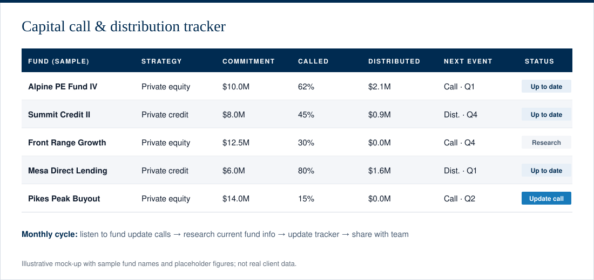

| | |
|:--|:--|
| **Business problem** | Private equity and private credit funds call capital and pay distributions on their own schedules, and the updates are scattered across fund calls and documents. The team needed one reliable, current view to manage **&#36;50M+ in client capital raises** so that no capital call caught a client by surprise. |
| **What I did** | I **monitored private equity and private credit fund update calls**, did **independent research** to find current fund information, and compiled everything into a **monthly capital call and distribution tracking spreadsheet** that the team used. I also maintained a comprehensive Excel tracker of **portfolio allocations across 95 client households (&#36;3.7B)**. |
| **Challenges** | Private-market information isn't standardized. Each fund reports differently, and some details only come up on calls. I had to learn private fund structures quickly, decide what the team actually needed to see, and keep the tracker accurate month after month. |
| **Artifacts** | The mock-up above shows the tracker's structure using sample fund names and placeholder numbers. |
| **Business value** | A single, up-to-date source for upcoming capital calls and distributions, so advisors could plan client liquidity ahead of time and manage &#36;50M+ in raises with confidence. |

<b>Search Visibility & Client Acquisition</b> &nbsp;·&nbsp; <i>Morgan Stanley PWM, 1550 Group · 2026</i> 
Restructured my team's bios for search and ran a Google Ads campaign to bring in new clients.

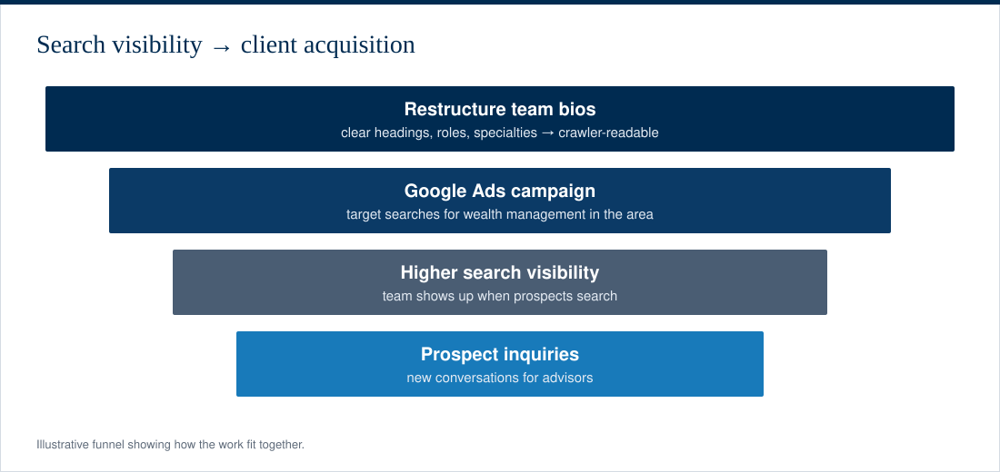

| | |
|:--|:--|
| **Business problem** | Wealthy prospects often start their search for an advisor online. If a team's bios aren't structured for search engines, the team is harder to find, even when it's a great fit. |
| **What I did** | I **reformatted the team's bios to improve website-crawler readability** and **ran a Google Ads campaign** to strengthen SEO and drive client acquisition. |
| **Challenges** | I had to balance two audiences: search engines that reward clear structure and keywords, and prospective clients who want a warm, credible introduction. I did this within the compliance standards of a regulated financial firm. |
| **Artifacts** | The funnel above shows how the pieces fit together. |
| **Business value** | A team that is easier to find online and a steadier pipeline of prospective clients for the advisors. |

---

  
  

